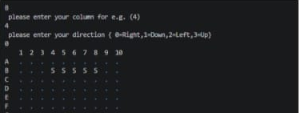
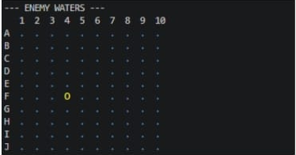
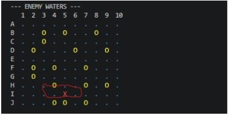

# PF_project

# Battleship Game

A console-based Battleship game written in C.

 Description

This project is a Battleship game where the player plays against the computer on a 10×10 board.

The player places their ships on the board by entering coordinates and directions. The computer places its ships randomly. Players then take turns attacking the opponent's board until all of one player's ships have been sunk.

 Features

- 10×10 game board
- Player-controlled ship placement
- Random computer ship placement
- Player attacks using coordinates
- Computer randomly chooses attack coordinates
- Hit and miss detection
- Ship sinking detection
- Displays the winner
- Saves game results to a match history file

 Ships

The game contains four ships:

- Aircraft Carrier — length 5
- Cruiser — length 4
- Destroyer — length 3
- Frigate — length 2

 How to Play

When prompted, enter a row using a letter from A to J and a column using a number from 1 to 10.

For example:

Row: B
Column: 4

When placing a ship, enter a direction:

0 = Right
1 = Down
2 = Left
3 = Up

The game continues until all ships belonging to one side have been destroyed.

 Game Results

After a game is completed, the result is saved to:

match history.txt

This file records whether the player or the computer won.

 Requirement

This program is designed to run on Windows because it uses Windows-specific console functionality such as `windows.h` and `Sleep()`.

A C compiler is required to compile the program.

 Compilation

Compile the file using the following format : 

 
 gcc filename.c -o battleship.exe

The program can then be run using:

.\battleship

##Test Cases : 

Test case 1 :   Case : Placing aircraft carrier  on row B and column 4  Expected output:  5 ' S ' starting from column 4 and ending at column 8. Actual output:   

Test case 2 :  Case: missing opponent ship  Expected output: a yellow ‘ O ‘ to signal a miss.  Actual output:  

Test case 3:  Case: hitting enemy ship  Expected output: a red  'X' to signal a hit.  Actual output

Test Cases

Test Case 4: Valid Ship Placement   

Test Case 5: Ship Placement Outside the Board  

Test Case 6: Overlapping Ships  

Test Case 7: Invalid Coordinates 

Test Case 8: Successful Hit 

Test Case 9: Missed Attack  

Test Case 10: Ship  Sunk 

Test Case 11: Repeated Attack 

Test case 12 : 

Test Case 13: Match History  

 

## 📋 Function Reference

### 🎮 Core Game Flow
* **`main()`**: The entry point of the program. Initializes boards, sets up player and AI fleets, runs the main game loop, and exits upon completion.
* **`manipulate_arrlocation()`**: Controls the active turn loop, processes hits and misses, updates status messages, and handles turn switching.
* **`turn_change()`**: Switches the active player turn (`PLAYER_ID`) if a shot misses the target.

### 🎨 Board & Display Functions
* **`board()`**: Initializes the 3D game board array with zeros, representing empty water.
* **`displayplayerboard()`**: Renders the human player's board with colored console markers for water, ships, hits, and misses.
* **`displaycpuboard()`**: Renders the computer's board, hiding active ships while displaying hits, misses, and open water.
* **`render_live_boards()`**: Refreshes and prints both boards in-place along with the current turn status and outcome message.
* **`spir()`**: Prints the raw integer matrix of a board grid (used primarily for debugging).

### ⌨️ Input & Validation Functions
* **`getcord()`**: Prompts the user to input and validates board coordinates (Row `A–J`, Column `1–10`).
* **`getdir()`**: Prompts and validates direction input for ship placement (`0 = Right, 1 = Down, 2 = Left, 3 = Up`).
* **`getcord_mechanism()`**: Directs coordinate acquisition depending on whether it is the human player's turn or the AI's turn.
* **`hit_input_mechanism()`**: Validates attack coordinates to ensure a cell hasn't already been targeted.
* **`vd()`**: Checks whether a specific board coordinate is empty water.

### 🚢 Ship Placement Functions
* **`sp()`**: Validates space and places a ship of a given length and direction onto the grid.
* **`user_da()`**: Guides the human player through placing their entire fleet (Carrier, Cruiser, Destroyer, Frigate).
* **`ai_da()`**: Manages the random placement of all AI fleet ships.
* **`sp_ai()`**: Attempts to place an individual ship randomly for the AI.
* **`dir_ai()`**: Generates a random direction for AI ship placement.
* **`sae()`**: Initializes default ship attributes, sizes, and tracking details.

### 🔄 Data Conversion & Array Management
* **`s3d_2d_ma()` / `s2d_3d_ma()`**: Copies and converts board grid data between 2D and 3D array structures.
* **`s3d_2d_sa()` / `s2d_3d_sa()`**: Copies and converts ship detail information between 2D and 3D array structures.

### 🛠️ Utility & File Management
* **`clear_screen()`**: Clears the console window display (`cls`).
* **`reset_cursor()`**: Resets the console cursor to the top-left corner for smooth in-place screen updates.
* **`get_microseconds()`**: Fetches high-precision timestamps in microseconds to serve as a random seed source.
* **`rc()`**: Generates random row and column indices.
* **`random_cordinate()`**: Generates random coordinates that haven't been targeted yet.
* **`save_results()`**: Appends match winner records to a text file named `match history.txt`.
* **`check_allship_sunk()`**: Checks if all ships for a specific player have been completely destroyed.
* **`winner_declare()`**: Announces the game winner and triggers the file-saving sequence.

 
